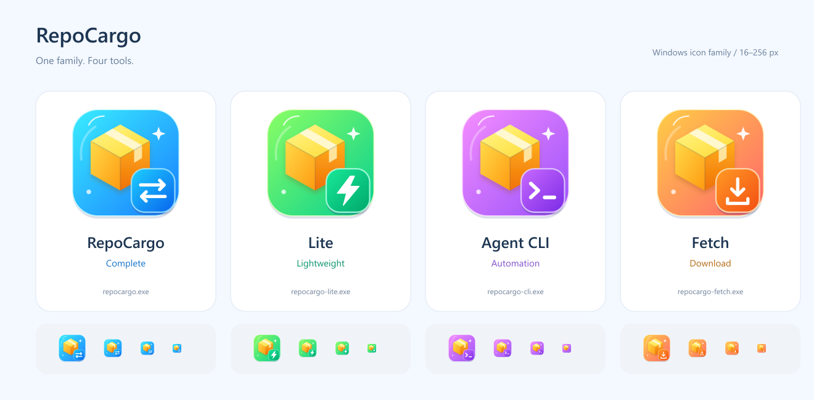

# RepoCargo

面向人和 AI Agent 的 Git 项目资源发布、下载与恢复工具：大文件放在 Git 仓库之外，配置、索引和资源版本随代码管理。

本仓库是 **Windows x64 成品与文档发行仓库**，当前版本 **0.2.0**。四个 EXE 可直接使用；本仓库不包含 RepoCargo 业务源码或产品构建脚本。开源许可与第三方组件的边界见 [LICENSE](LICENSE) 和 [第三方声明](THIRD_PARTY_NOTICES.md)。



## 四个成品如何选择

| 文件 | 用途 | 运行条件 |
| --- | --- | --- |
| [repocargo.exe](repocargo.exe) | 完整上传、下载、索引清理、桌面 GUI；业务协议基准 | 自带 Python 运行时，首次启动需要可写缓存目录 |
| [repocargo-lite.exe](repocargo-lite.exe) | 精简上传、下载、索引清理、文本菜单 | `curl.exe`；部分完整版能力不提供 |
| [repocargo-cli.exe](repocargo-cli.exe) | Agent 状态检查、预演、确认、超时及结构化诊断 | 默认调用同目录完整版；可显式选择 Lite |
| [repocargo-fetch.exe](repocargo-fetch.exe) | 按 HTTP/HTTPS/FTP 发布索引下载、校验及部署 | `curl.exe`；不提供上传，也不是 CLI 的默认后端 |

无需为这四个成品安装 Python、Rust 或开发依赖。涉及 Git 检查和暂存的操作需要 `git.exe`。当前只提供 Windows x64 EXE，不提供 Linux/macOS 成品。

## 先验证再运行

```powershell
git clone https://github.com/hawkhai/repocargo.git
cd repocargo
$checksums = Get-Content .\SHA256.json -Raw | ConvertFrom-Json
foreach ($entry in $checksums.PSObject.Properties) {
    $actual = (Get-FileHash -LiteralPath $entry.Name -Algorithm SHA256).Hash.ToLowerInvariant()
    if ($actual -ne $entry.Value) { throw "SHA-256 mismatch: $($entry.Name)" }
}
.\repocargo.exe --version
.\repocargo-cli.exe --help
```

[release.json](release.json) 记录各成品的版本、大小和 SHA-256；[SHA256SUMS](SHA256SUMS) 供常见校验工具使用。

## 无需凭据的离线试用

在本仓库根目录运行：

```powershell
.\repocargo-cli.exe status --project .\examples\basic --json
.\repocargo-cli.exe upload --project .\examples\basic --dry-run --json
.\repocargo-cli.exe --program .\repocargo-lite.exe upload --project .\examples\basic --dry-run --json
```

这三条命令读取示例并展示计划，不启动传输后端、不联网、不写项目。`status` 只代表本地配置状态，不能证明远端存在或资源完整。示例没有发布过，目录 ID 尚不存在是正常状态。

## 使用自己的项目

将 [示例配置](examples/basic/repocargo.yaml) 复制到自己的项目目录，按实际资源修改 `others`，显式填写自己的 FTP 服务和账号。密码通过配置中 `pypass` 指定的环境变量提供，不写入 Git。

```powershell
# $project 改为自己的资源项目目录；以下示例域名不能直接用于真实传输。
$project = 'C:\demo-project'
$env:REPOCARGO_FTP_PASSWORD = '<your-password>'
.\repocargo-cli.exe status --project $project --json
.\repocargo-cli.exe upload --project $project --dry-run --json
# 确认计划及副作用后，再执行实际操作。
.\repocargo-cli.exe upload --project $project --yes --no-input --json
.\repocargo-cli.exe download --project $project --no-input --json
```

下载已有项目还需要发布方提供匹配的配置和目录 ID 文件。只知道 CDN 地址时使用 Fetch：

```powershell
.\repocargo-fetch.exe download --url https://cdn.example.invalid/repocargo/demo/release_001/ --output C:\demo-output --json
```

先将占位 URL 换成自己的有效发布地址。Fetch 的 URL 目录需要有 `version.txt` 及其对应的 `version/<版本>.txt` 索引和资源；本仓库不是演示资源服务器。

## 交给 AI 使用

让 AI 先读 [AGENTS.md](AGENTS.md)，再读 [Agent 指南](docs/agent.md)。Agent 应先校验成品哈希，再做 `status` / `--dry-run`，按实际后端能力和用户授权执行操作。

## 文档地图

- [完整命令、能力差异及配置字段](docs/usage.md)
- [配置与凭据](docs/configuration.md)
- [资源交换协议](docs/protocol.md)
- [Agent 命令、错误和结果语义](docs/agent.md)
- [Fetch 下载与部署动作](docs/fetch.md)
- [JSON/YAML 迁移与旧工具共存](docs/migration.md)
- [已知限制与平台边界](docs/limitations.md)
- [本次成品核验记录](docs/validation.md)
- [版本记录](CHANGELOG.md)、[贡献与同步规则](CONTRIBUTING.md)

## 与旧版的关系

gitbigfileftp 继续作为独立工具保留 JSON 配置及旧入口。RepoCargo 使用 `repocargo.yaml`、显式子命令和独立远端命名空间；不会自动转换旧配置。新旧工具应使用独立工作目录、输出目录和扫描范围。

## RepoGit：无需客户账号的 Git 同步

[RepoGit 成品与文档](repogit/README.md) 使用 GitLab Deploy Key 或可转交的授权配置，同步已有 Git 项目。RepoGit 0.3.0 提供 [人类版 EXE](repogit/repogit.exe)、[独立 Agent CLI](repogit/repogit-cli.exe)、[Agent 协议](repogit/docs/AGENT_PROTOCOL.md)、[便携 ZIP](repogit/repogit-windows-x64.zip)、[完整操作步骤](repogit/docs/QUICKSTART.md) 和 [管理员授权说明](repogit/docs/GITLAB_SETUP.md)。需要 Git 与 OpenSSH；请使用 `repogit/` 内独立的校验清单和验证记录。

## English

RepoCargo keeps large assets outside Git while tracking their configuration, indexes and version identifiers alongside code. This repository ships four Windows x64 executables, public documentation, safe examples and icon assets. Business source code and product build scripts are intentionally not included. Start with `AGENTS.md`, verify `SHA256.json`, and use `repocargo-cli.exe status` and `--dry-run` before an authorized operation. Project configuration is YAML, and the old gitbigfileftp product remains independent.
